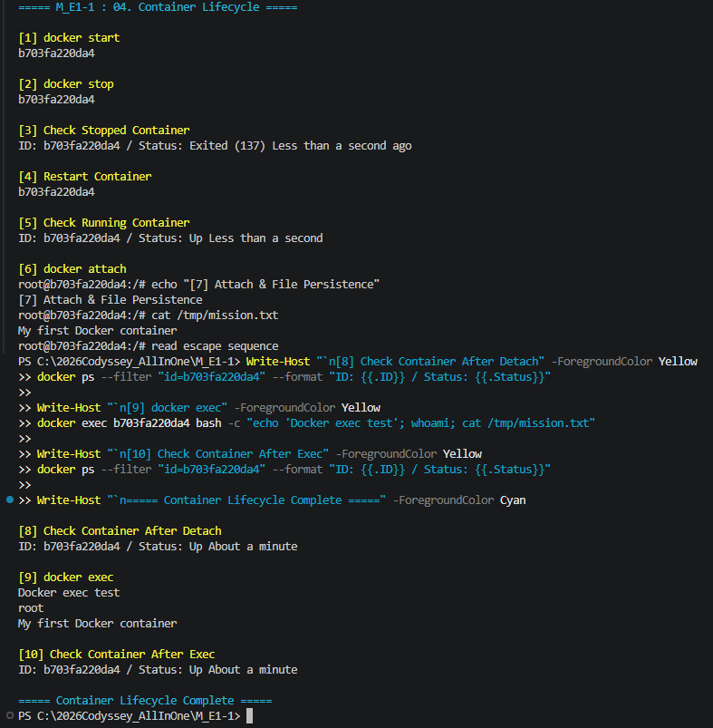
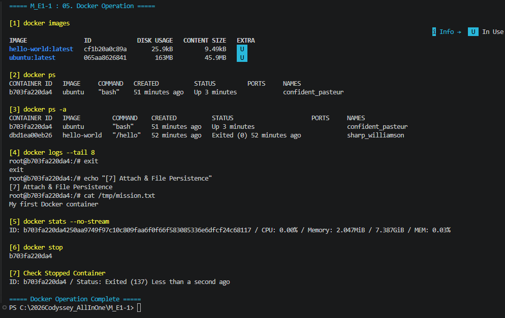
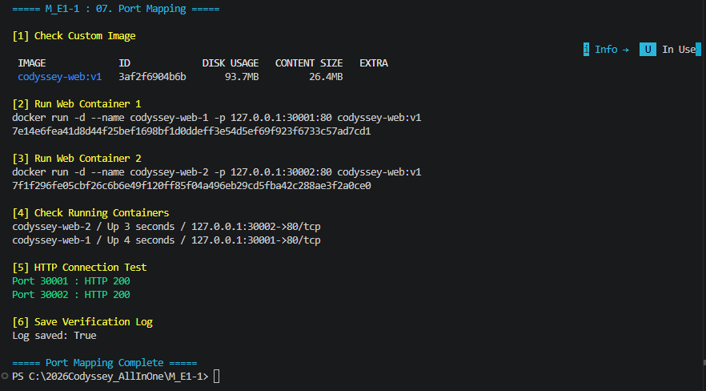
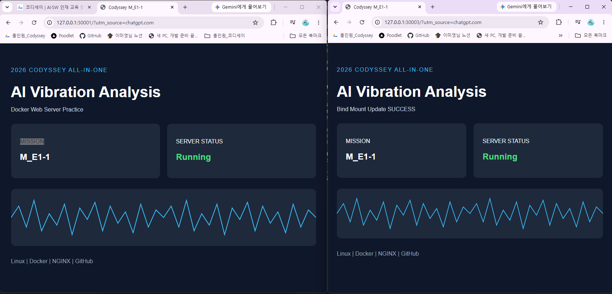
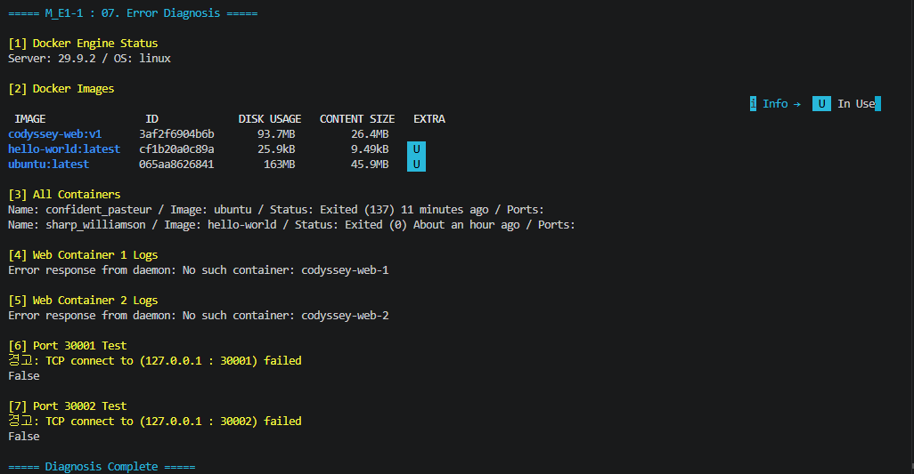
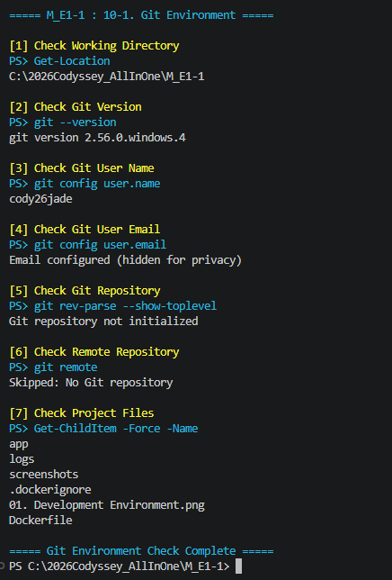
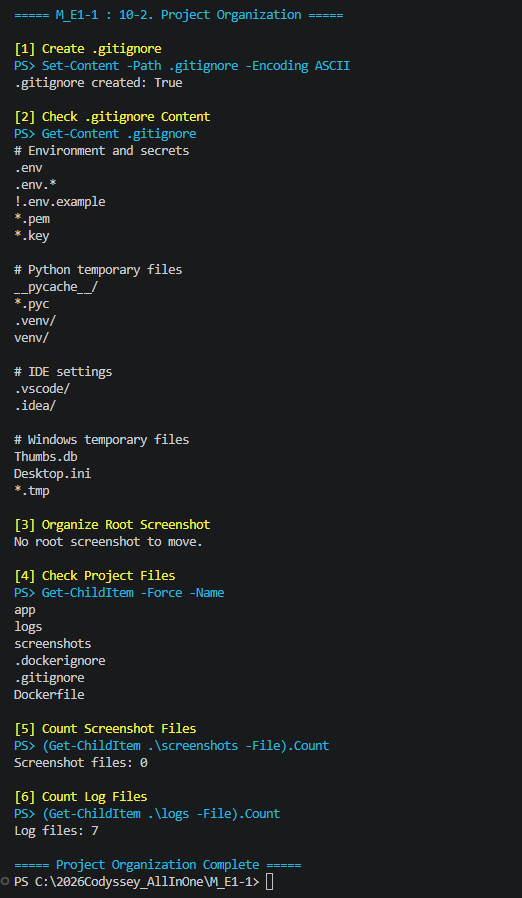
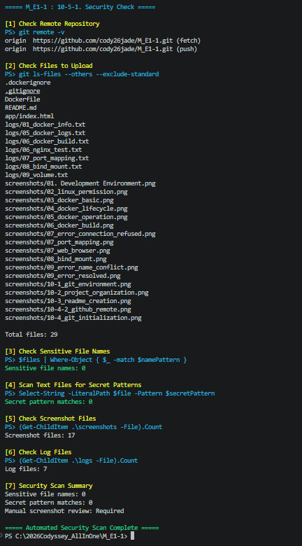

# M_E1-1. 내 컴퓨터에 개발자용 작업실 꾸미기

> 2026 Codyssey AI All-in-One
>
> Linux, Docker, NGINX, Git, GitHub 기반 개발 환경 구축 실습

## 1. 프로젝트 개요

본 프로젝트는 개발에 필요한 기본 환경을 구축하고,
Linux 명령어, Docker 컨테이너, 웹 서버 및 Git의
기본 사용 방법을 학습하기 위해 수행하였다.

향후 제조 현장의 진동 데이터 분석 및 AI Agent 개발에
활용할 수 있는 기초 개발 환경 구축을 목표로 한다.

### 수행 목적

- Linux 기본 명령어 및 파일 권한 이해
- Docker 이미지와 컨테이너의 개념 이해
- Docker 컨테이너 생성 및 운영
- Dockerfile을 활용한 이미지 제작
- NGINX 웹 서버 구축
- 포트 매핑을 활용한 웹페이지 접속
- Bind Mount 및 Volume을 활용한 데이터 관리
- Git과 GitHub를 활용한 버전 관리

## 2. 개발 환경

| 구분 | 개발 환경 |
|---|---|
| OS | Windows 11 Pro |
| Terminal | Windows PowerShell |
| Editor | Visual Studio Code |
| WSL | WSL 2 |
| Git | 2.56.0.windows.4 |
| Docker Engine | 29.9.2 |
| Container OS | Linux |
| Web Server | NGINX |
| Language | HTML, Shell, PowerShell |

### 개발 환경 확인 명령어

```powershell
git --version
docker --version
docker info
wsl -l -v
```


[Docker 환경 확인 로그](logs/01_docker_info.txt)

## 3. 프로젝트 구조

```text
M_E1-1/
├── app/
│   └── index.html
├── logs/
├── screenshots/
├── .dockerignore
├── .gitignore
├── Dockerfile
└── README.md
```

| 파일 및 폴더 | 설명 |
|---|---|
| app/index.html | 웹페이지 소스코드 |
| Dockerfile | Docker 이미지 제작 설정 |
| .dockerignore | Docker 빌드 제외 설정 |
| .gitignore | Git 관리 제외 설정 |
| logs | 실습 실행 및 검증 로그 |
| screenshots | 실습 수행 증빙 이미지 |
| README.md | 프로젝트 설명 및 수행 보고서 |

## 4. Linux 기본 명령어 및 파일 권한

### 실습 목적

Linux 환경에서 파일과 폴더를 관리하고
읽기, 쓰기, 실행 권한의 개념을 이해한다.

### 주요 학습 명령어

```bash
pwd
ls -la
mkdir
cd
touch
echo
cat
cp
mv
rm
chmod
```

| 명령어 | 설명 |
|---|---|
| pwd | 현재 작업 경로 확인 |
| ls | 파일 및 폴더 목록 확인 |
| mkdir | 폴더 생성 |
| cd | 작업 경로 이동 |
| touch | 파일 생성 |
| cat | 파일 내용 출력 |
| cp | 파일 복사 |
| mv | 파일 이동 또는 이름 변경 |
| rm | 파일 삭제 |
| chmod | 파일 및 폴더 권한 변경 |

### 실습 증빙


## 5. Docker 기본 실행

### 실습 목적

Docker 이미지와 컨테이너의 차이를 이해하고
Ubuntu 컨테이너를 실행한다.

### 주요 명령어

```powershell
docker run hello-world
docker run -it ubuntu bash
docker images
docker ps -a
```

- Image: 컨테이너 실행에 필요한 프로그램 및 환경의 묶음
- Container: 이미지를 기반으로 생성된 실행 환경
- Ubuntu: Linux 배포판
- Bash: Linux 명령어를 입력하고 실행하는 셸

### 실습 증빙


## 6. Docker 컨테이너 생명주기

### 실습 목적

컨테이너의 생성, 실행, 종료 및 재실행 방법을 이해한다.

### 주요 명령어 형식

```powershell
docker run -it ubuntu bash
docker ps
docker ps -a
docker start CONTAINER
docker attach CONTAINER
docker exec -it CONTAINER bash
docker stop CONTAINER
```

| 명령어 | 설명 |
|---|---|
| run | 새로운 컨테이너 생성 및 실행 |
| start | 기존 컨테이너 실행 |
| attach | 실행 중인 컨테이너의 주 프로세스에 연결 |
| exec | 실행 중인 컨테이너에서 추가 명령 실행 |
| stop | 컨테이너 실행 중지 |

### 실습 증빙



## 7. Docker 운영 및 관리

### 실습 목적

Docker 이미지와 컨테이너의 실행 상태,
로그 및 시스템 자원 사용 현황을 확인한다.

### 주요 명령어

```powershell
docker images
docker ps -a
docker logs CONTAINER
docker stats --no-stream
```

### 실습 증빙



[Docker 운영 로그](logs/05_docker_logs.txt)

## 8. Dockerfile 및 이미지 빌드

### 실습 목적

Dockerfile을 이용하여 HTML 웹페이지가 포함된
NGINX 기반 커스텀 Docker 이미지를 제작한다.

### 주요 명령어

```powershell
docker build -t codyssey-web:v1 .
docker images codyssey-web
docker run --rm codyssey-web:v1 nginx -t
```

### 확인된 이미지 정보

| 항목 | 결과 |
|---|---|
| 이미지 이름 | codyssey-web:v1 |
| 이미지 ID | 3af2f6904b6b |
| Disk Usage | 93.7 MB |
| Content Size | 26.4 MB |

### 관련 소스코드

- [Dockerfile](Dockerfile)
- [HTML Source](app/index.html)
- [.dockerignore](.dockerignore)

### 실습 증빙


- [Docker Build Log](logs/06_docker_build.txt)
- [NGINX Test Log](logs/06_nginx_test.txt)

## 9. NGINX 웹 서버 및 포트 매핑

### 실습 목적

동일한 Docker 이미지로 두 개의 웹 서버를 생성하고
서로 다른 호스트 포트로 접속한다.

### 실행 명령어

```powershell
docker run -d --name codyssey-web-1 -p 127.0.0.1:30001:80 codyssey-web:v1

docker run -d --name codyssey-web-2 -p 127.0.0.1:30002:80 codyssey-web:v1
```

### 실행 결과

| 컨테이너 | 호스트 포트 | 내부 포트 | HTTP 응답 |
|---|---:|---:|---|
| codyssey-web-1 | 30001 | 80 | 200 |
| codyssey-web-2 | 30002 | 80 | 200 |

### 접속 주소

- http://127.0.0.1:30001
- http://127.0.0.1:30002

### 실습 증빙




[포트 매핑 검증 로그](logs/07_port_mapping.txt)

## 10. Docker Bind Mount

### 실습 목적

Windows의 HTML 파일을 컨테이너 내부에 연결하여
이미지를 다시 빌드하지 않고 변경 사항을 반영한다.

### 실행 명령어

```powershell
$appPath = (Resolve-Path .\app).Path

docker run -d --name codyssey-bind -p 127.0.0.1:30003:80 -v "${appPath}:/usr/share/nginx/html:ro" codyssey-web:v1
```

### 실습 구성

| 항목 | 설정 |
|---|---|
| 컨테이너 | codyssey-bind |
| 접속 포트 | 30003 |
| Windows 경로 | app |
| Container 경로 | /usr/share/nginx/html |
| 접근 방식 | Read Only |

### 검증 방법

- 기존 이미지 기반 웹 서버와 Bind Mount 웹 서버 비교
- Windows의 index.html 파일 수정
- 이미지 재빌드 없이 변경 사항 반영 여부 확인

### 실습 증빙



[Bind Mount 검증 로그](logs/08_bind_mount.txt)

## 11. Docker Volume

### 실습 목적

컨테이너를 삭제하고 다시 생성하더라도
별도의 Volume에 저장된 데이터를 유지할 수 있는지 확인한다.

### 주요 실행 명령어

```powershell
docker volume create codyssey-data

docker run --name codyssey-volume-1 -v codyssey-data:/data ubuntu bash -c "echo 'Codyssey Volume Persistence Test' > /data/mission.txt; cat /data/mission.txt"

docker rm codyssey-volume-1

docker volume ls

docker run --name codyssey-volume-2 -v codyssey-data:/data ubuntu cat /data/mission.txt
```

### 데이터 재확인 결과

```text
Codyssey Volume Persistence Test
Data preserved: True
Exited (0)
```

기존 컨테이너를 다시 실행하여 저장된 데이터가
정상적으로 읽히는 것을 확인하였다.


[Volume 실습 로그](logs/09_volume.txt)

### Bind Mount와 Volume 비교

| 항목 | Bind Mount | Volume |
|---|---|---|
| 저장 위치 | 사용자 지정 경로 | Docker 관리 영역 |
| 주요 용도 | 소스코드 개발 | 영구 데이터 저장 |
| 컨테이너 삭제 후 데이터 유지 | 가능 | 가능 |
| Windows에서 직접 수정 | 가능 | 일반적으로 사용하지 않음 |

## 12. Troubleshooting

### 사례 1. 웹 서버 접속 오류

#### 오류 현상

localhost:30001 접속 시 ERR_CONNECTION_REFUSED 발생.



#### 원인 분석

- Docker Engine 정상
- codyssey-web:v1 이미지 존재
- 웹 서버 컨테이너 미생성
- 최초 미생성 이유는 확인되지 않음

#### 해결 방법

```powershell
docker run -d --name codyssey-web-1 -p 127.0.0.1:30001:80 codyssey-web:v1

docker run -d --name codyssey-web-2 -p 127.0.0.1:30002:80 codyssey-web:v1
```

#### 해결 결과

두 웹 서버 모두 HTTP 200 응답 확인.


### 사례 2. 컨테이너 이름 중복 오류

#### 오류 현상

이미 존재하는 codyssey-volume-2 이름으로
새로운 컨테이너를 생성하여 Conflict 오류 발생.


#### 원인 분석

docker run은 새로운 컨테이너를 생성한다.
이미 존재하는 컨테이너 이름은 중복 사용할 수 없다.

#### 해결 방법

```powershell
docker start -a codyssey-volume-2
```

#### 해결 결과

```text
Codyssey Volume Persistence Test
Data preserved: True
Exited (0)
```

기존 컨테이너 및 Volume을 삭제하지 않고
저장 데이터를 정상적으로 확인하였다.


## 13. Git 및 GitHub

### Git 환경 확인

```powershell
git --version
git config user.name
git config user.email
git rev-parse --show-toplevel
git remote
```



### 프로젝트 파일 정리

.gitignore 파일을 생성하여 비밀번호,
API Key 및 불필요한 임시 파일의 관리 제외 규칙을 설정하였다.



### Git 버전 관리 절차

```text
Working Directory
    ↓ git add
Staging Area
    ↓ git commit
Local Repository
    ↓ git push
GitHub Remote Repository
```

GitHub 원격 저장소 연결을 완료하였다. 최종 업로드는 후속 단계에서 수행한다.

## 14. 학습 내용 및 향후 활용 계획

이번 실습을 통해 Linux 명령어, Docker 이미지와 컨테이너,
웹 서버 구축 및 데이터 저장 방식의 기본 개념을 학습하였다.

특히 Docker를 이용하면 개발 환경을 일관되게 구성하고,
동일한 이미지를 기반으로 여러 실행 환경을 구축할 수 있다.

향후 제조 현장의 AI Agent 개발에 다음과 같이 활용할 계획이다.

- 공작기계 주축 진동 분석 프로그램 개발
- FFT 및 베어링 결함 분석 서비스 구축
- FastAPI 기반 AI Agent 컨테이너화
- Bind Mount를 활용한 소스코드 개발
- Volume을 활용한 분석 데이터 저장
- GitHub 기반 소스코드 버전 관리

---

## 15. GitHub 저장소 구축 및 보안 점검

### GitHub 저장소

- Repository: M_E1-1
- Owner: cody26jade
- Branch: main
- Visibility requirement: Public
- Repository URL: https://github.com/cody26jade/M_E1-1

### Git 저장소 초기화

```powershell
git init -b main
git branch --show-current
git status --short
```


### GitHub 원격 저장소 연결

```powershell
git remote add origin https://github.com/cody26jade/M_E1-1.git
git remote -v
git remote get-url origin
git ls-remote origin
```

### 원격 저장소 연결 결과

| 검증 항목 | 결과 |
|---|---|
| Origin registration | Success |
| URL verified | True |
| GitHub access verified | True |
| Branch | main |


### 업로드 전 보안 점검

코디세이 동료평가를 위해 GitHub 저장소는
Public으로 제출하는 것을 원칙으로 한다.

공개 저장소에 API Key, 비밀번호 및 개인정보가
포함되지 않도록 업로드 전에 점검하였다.

```powershell
git ls-files --others --exclude-standard
```

### 자동 보안 점검 결과

| 점검 항목 | 점검 당시 결과 |
|---|---:|
| 업로드 대상 파일 | 29 |
| 스크린샷 | 17 |
| 실행 로그 | 7 |
| 기타 프로젝트 파일 | 5 |
| 민감정보 의심 파일명 | 0 |
| 비밀정보 패턴 검출 | 0 |

위 수치는 최초 자동 보안 점검 시점의 결과이며,
이후 증빙 파일 추가에 따라 전체 파일 수는 변경될 수 있다.

자동 검사만으로 모든 민감정보를 확인할 수 없으므로
공개 전 스크린샷과 로그를 별도로 검토해야 한다.



## 16. 프로젝트 재현 방법

본 프로젝트는 다른 개발자 및 동료평가자가
동일한 웹 서버 실행 환경을 구축할 수 있도록 구성하였다.

### 16.1 필수 설치 프로그램

- Git
- Docker Desktop 또는 Docker Engine
- 웹브라우저
- Visual Studio Code (권장)

Windows 환경에서는 Docker Desktop을 실행하고
Docker Engine이 정상적으로 작동하는지 확인한다.

```powershell
git --version
docker --version
docker info
```

### 16.2 GitHub 저장소 복제

GitHub 업로드가 완료된 후 다음 명령어를 실행한다.

```powershell
git clone https://github.com/cody26jade/M_E1-1.git
cd M_E1-1
```

### 16.3 Docker 이미지 빌드

```powershell
docker build -t codyssey-web:v1 .
```

### 16.4 NGINX 설정 확인

```powershell
docker run --rm codyssey-web:v1 nginx -t
```

### 16.5 웹 서버 실행

30001 포트가 사용 중이지 않은지 확인한 후 실행한다.

```powershell
docker run -d --name codyssey-review -p 127.0.0.1:30001:80 codyssey-web:v1
```

### 16.6 웹브라우저 접속

http://localhost:30001

### 16.7 웹 서버 응답 확인

```powershell
docker ps
(Invoke-WebRequest -Uri http://localhost:30001 -UseBasicParsing).StatusCode
```

예상 HTTP 응답 코드: 200

### 16.8 실습 종료

```powershell
docker stop codyssey-review
docker rm codyssey-review
```

위 명령어는 동료평가용 컨테이너만 중지하고 삭제한다.

## 17. 최종 제출 체크리스트

- [x] 개발 환경 구축
- [x] Linux 기본 명령어 및 파일 권한 실습
- [x] Docker 기본 실행
- [x] Docker 컨테이너 생명주기 실습
- [x] Docker 운영 및 관리
- [x] Dockerfile 및 이미지 빌드
- [x] NGINX 웹 서버 및 포트 매핑
- [x] Bind Mount 실습
- [x] Docker Volume 실습
- [x] Troubleshooting 사례 정리
- [x] Git 저장소 초기화
- [x] GitHub 원격 저장소 연결
- [x] 자동 보안 점검
- [ ] 스크린샷 및 로그 수동 보안 점검
- [ ] Git Add 및 Commit
- [ ] GitHub Push
- [ ] Public 저장소 확인
- [ ] 최종 제출 검증

---

**2026 Codyssey AI All-in-One | M_E1-1**

