# M_E1-1. 내 컴퓨터에 개발자용 작업실 꾸미기

> 2026 Codyssey AI All-in-One
>
> Linux, Docker, NGINX, Git, GitHub 기반 개발 환경 구축 실습

## 1. 프로젝트 개요

본 프로젝트는 개발에 필요한 기본 환경을 구축하고,
Linux 명령어, Docker 컨테이너, 웹 서버 및 Git의
기본 사용 방법을 학습하기 위해 수행하였다.

향후 제조 현장의 진동 데이터 분석 및 AI Agent 개발에
활용할 수 있는 기초 개발 환경 구축을 목표로 한다.

### 수행 목적

- Linux 기본 명령어 및 파일 권한 이해
- Docker 이미지와 컨테이너의 개념 이해
- Docker 컨테이너 생성 및 운영
- Dockerfile을 활용한 이미지 제작
- NGINX 웹 서버 구축
- 포트 매핑을 활용한 웹페이지 접속
- Bind Mount 및 Volume을 활용한 데이터 관리
- Git과 GitHub를 활용한 버전 관리

## 2. 개발 환경

| 구분 | 개발 환경 |
|---|---|
| OS | Windows 11 Pro |
| Terminal | Windows PowerShell |
| Editor | Visual Studio Code |
| WSL | WSL 2 |
| Git | 2.56.0.windows.4 |
| Docker Engine | 29.9.2 |
| Container OS | Linux |
| Web Server | NGINX |
| Language | HTML, Shell, PowerShell |

### 개발 환경 확인 명령어

```powershell
git --version
docker --version
docker info
wsl -l -v
```


[Docker 환경 확인 로그](logs/01_docker_info.txt)

## 3. 프로젝트 구조

```text
M_E1-1/
├── app/
│   └── index.html
├── logs/
├── screenshots/
├── scripts/
├── .dockerignore
├── .gitignore
├── Dockerfile
└── README.md
```

| 파일 및 폴더 | 설명 |
|---|---|
| app/index.html | 웹페이지 소스코드 |
| Dockerfile | Docker 이미지 제작 설정 |
| .dockerignore | Docker 빌드 제외 설정 |
| .gitignore | Git 관리 제외 설정 |
| logs | 실습 실행 및 검증 로그 |
| screenshots | 실습 수행 증빙 이미지 |
| scripts | Linux 실습 재현용 Bash 스크립트 |
| README.md | 프로젝트 설명 및 수행 보고서 |

## 4. Linux 기본 명령어 및 파일 권한

### 실습 목적

Linux 환경에서 파일과 폴더를 관리하고
읽기, 쓰기, 실행 권한의 개념을 이해한다.

### 주요 학습 명령어

```bash
pwd
ls -la
mkdir
cd
touch
echo
cat
cp
mv
rm
chmod
```

| 명령어 | 설명 |
|---|---|
| pwd | 현재 작업 경로 확인 |
| ls | 파일 및 폴더 목록 확인 |
| mkdir | 폴더 생성 |
| cd | 작업 경로 이동 |
| touch | 파일 생성 |
| cat | 파일 내용 출력 |
| cp | 파일 복사 |
| mv | 파일 이동 또는 이름 변경 |
| rm | 파일 삭제 |
| chmod | 파일 및 폴더 권한 변경 |

### 실습 증빙

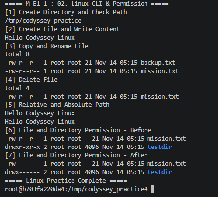

## 5. Docker 기본 실행

### 실습 목적

Docker 이미지와 컨테이너의 차이를 이해하고
Ubuntu 컨테이너를 실행한다.

### 주요 명령어

```powershell
docker run hello-world
docker run -it ubuntu bash
docker images
docker ps -a
```

- Image: 컨테이너 실행에 필요한 프로그램 및 환경의 묶음
- Container: 이미지를 기반으로 생성된 실행 환경
- Ubuntu: Linux 배포판
- Bash: Linux 명령어를 입력하고 실행하는 셸

### 실습 증빙

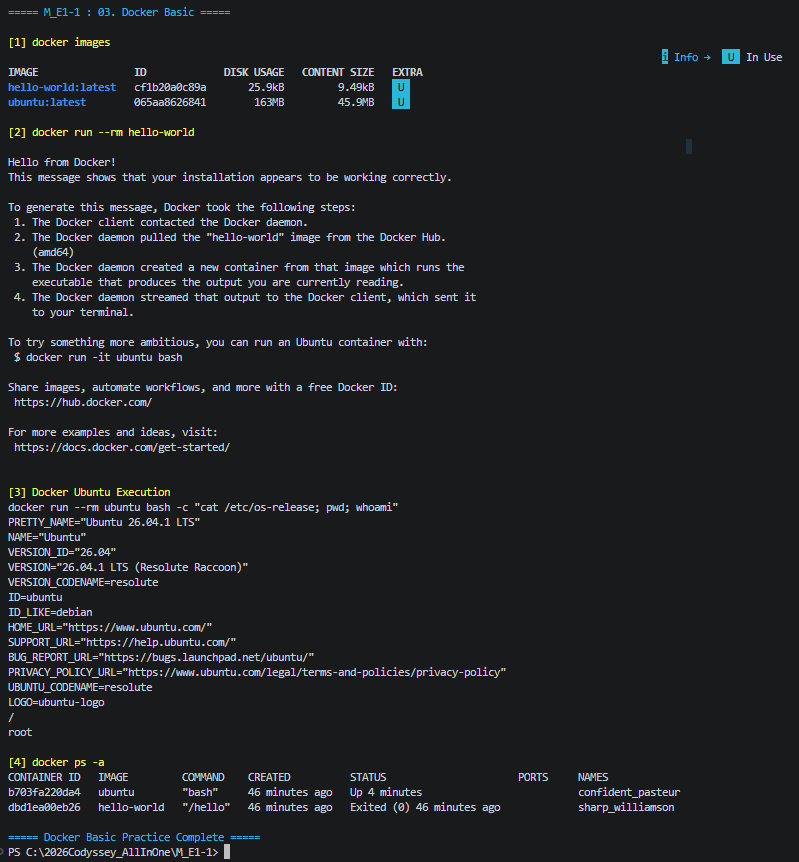

## 6. Docker 컨테이너 생명주기

### 실습 목적

컨테이너의 생성, 실행, 종료 및 재실행 방법을 이해한다.

### 주요 명령어 형식

```powershell
docker run -it ubuntu bash
docker ps
docker ps -a
docker start CONTAINER
docker attach CONTAINER
docker exec -it CONTAINER bash
docker stop CONTAINER
```

| 명령어 | 설명 |
|---|---|
| run | 새로운 컨테이너 생성 및 실행 |
| start | 기존 컨테이너 실행 |
| attach | 실행 중인 컨테이너의 주 프로세스에 연결 |
| exec | 실행 중인 컨테이너에서 추가 명령 실행 |
| stop | 컨테이너 실행 중지 |

### 실습 증빙


## 7. Docker 운영 및 관리

### 실습 목적

Docker 이미지와 컨테이너의 실행 상태,
로그 및 시스템 자원 사용 현황을 확인한다.

### 주요 명령어

```powershell
docker images
docker ps -a
docker logs CONTAINER
docker stats --no-stream
```

### 실습 증빙


[Docker 운영 로그](logs/05_docker_logs.txt)

## 8. Dockerfile 및 이미지 빌드

### 실습 목적

Dockerfile을 이용하여 HTML 웹페이지가 포함된
NGINX 기반 커스텀 Docker 이미지를 제작한다.

### 주요 명령어

```powershell
docker build -t codyssey-web:v1 .
docker images codyssey-web
docker run --rm codyssey-web:v1 nginx -t
```

### 확인된 이미지 정보

| 항목 | 결과 |
|---|---|
| 이미지 이름 | codyssey-web:v1 |
| 이미지 ID | 3af2f6904b6b |
| Disk Usage | 93.7 MB |
| Content Size | 26.4 MB |

### 관련 소스코드

- [Dockerfile](Dockerfile)
- [HTML Source](app/index.html)
- [.dockerignore](.dockerignore)

### 실습 증빙

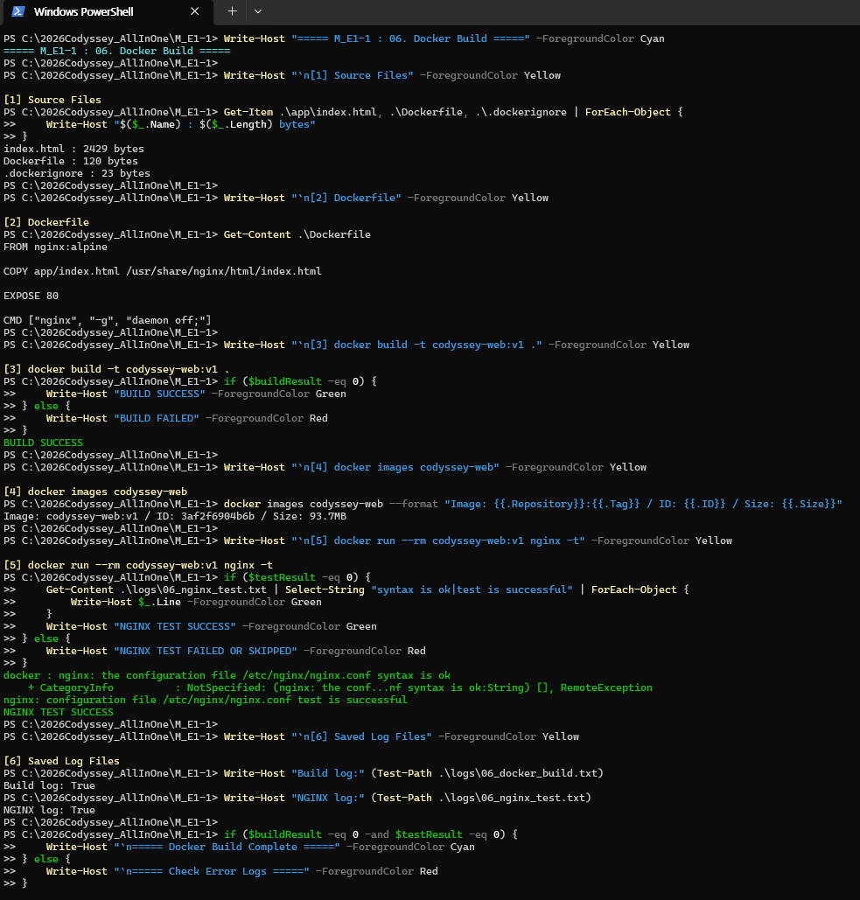

- [Docker Build Log](logs/06_docker_build.txt)
- [NGINX Test Log](logs/06_nginx_test.txt)

## 9. NGINX 웹 서버 및 포트 매핑

### 실습 목적

동일한 Docker 이미지로 두 개의 웹 서버를 생성하고
서로 다른 호스트 포트로 접속한다.

### 실행 명령어

```powershell
docker run -d --name codyssey-web-1 -p 127.0.0.1:30001:80 codyssey-web:v1

docker run -d --name codyssey-web-2 -p 127.0.0.1:30002:80 codyssey-web:v1
```

### 실행 결과

| 컨테이너 | 호스트 포트 | 내부 포트 | HTTP 응답 |
|---|---:|---:|---|
| codyssey-web-1 | 30001 | 80 | 200 |
| codyssey-web-2 | 30002 | 80 | 200 |

### 접속 주소

- http://127.0.0.1:30001
- http://127.0.0.1:30002

### 실습 증빙


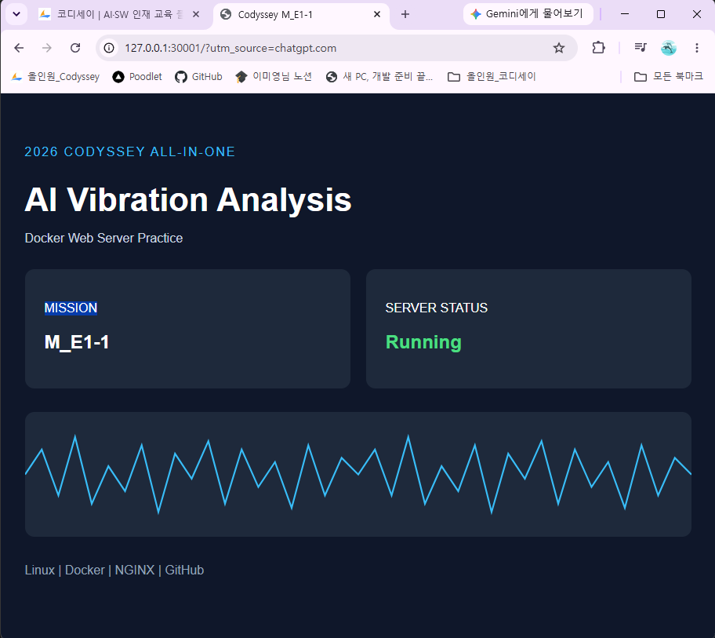

[포트 매핑 검증 로그](logs/07_port_mapping.txt)

## 10. Docker Bind Mount

### 실습 목적

Windows의 HTML 파일을 컨테이너 내부에 연결하여
이미지를 다시 빌드하지 않고 변경 사항을 반영한다.

### 실행 명령어

```powershell
$appPath = (Resolve-Path .\app).Path

docker run -d --name codyssey-bind -p 127.0.0.1:30003:80 -v "${appPath}:/usr/share/nginx/html:ro" codyssey-web:v1
```

### 실습 구성

| 항목 | 설정 |
|---|---|
| 컨테이너 | codyssey-bind |
| 접속 포트 | 30003 |
| Windows 경로 | app |
| Container 경로 | /usr/share/nginx/html |
| 접근 방식 | Read Only |

### 검증 방법

- 기존 이미지 기반 웹 서버와 Bind Mount 웹 서버 비교
- Windows의 index.html 파일 수정
- 이미지 재빌드 없이 변경 사항 반영 여부 확인

### 실습 증빙


[Bind Mount 검증 로그](logs/08_bind_mount.txt)

## 11. Docker Volume

### 실습 목적

컨테이너를 삭제하고 다시 생성하더라도
별도의 Volume에 저장된 데이터를 유지할 수 있는지 확인한다.

### 주요 실행 명령어

```powershell
docker volume create codyssey-data

docker run --name codyssey-volume-1 -v codyssey-data:/data ubuntu bash -c "echo 'Codyssey Volume Persistence Test' > /data/mission.txt; cat /data/mission.txt"

docker rm codyssey-volume-1

docker volume ls

docker run --name codyssey-volume-2 -v codyssey-data:/data ubuntu cat /data/mission.txt
```

### 데이터 재확인 결과

```text
Codyssey Volume Persistence Test
Data preserved: True
Exited (0)
```

기존 컨테이너를 다시 실행하여 저장된 데이터가
정상적으로 읽히는 것을 확인하였다.

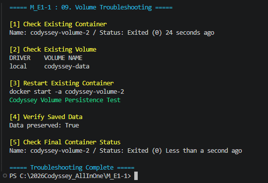

[Volume 실습 로그](logs/09_volume.txt)

### Bind Mount와 Volume 비교

| 항목 | Bind Mount | Volume |
|---|---|---|
| 저장 위치 | 사용자 지정 경로 | Docker 관리 영역 |
| 주요 용도 | 소스코드 개발 | 영구 데이터 저장 |
| 컨테이너 삭제 후 데이터 유지 | 가능 | 가능 |
| Windows에서 직접 수정 | 가능 | 일반적으로 사용하지 않음 |

## 12. Troubleshooting

### 사례 1. 웹 서버 접속 오류

#### 오류 현상

localhost:30001 접속 시 ERR_CONNECTION_REFUSED 발생.


#### 원인 분석

- Docker Engine 정상
- codyssey-web:v1 이미지 존재
- 웹 서버 컨테이너 미생성
- 최초 미생성 이유는 확인되지 않음

#### 해결 방법

```powershell
docker run -d --name codyssey-web-1 -p 127.0.0.1:30001:80 codyssey-web:v1

docker run -d --name codyssey-web-2 -p 127.0.0.1:30002:80 codyssey-web:v1
```

#### 해결 결과

두 웹 서버 모두 HTTP 200 응답 확인.


### 사례 2. 컨테이너 이름 중복 오류

#### 오류 현상

이미 존재하는 codyssey-volume-2 이름으로
새로운 컨테이너를 생성하여 Conflict 오류 발생.

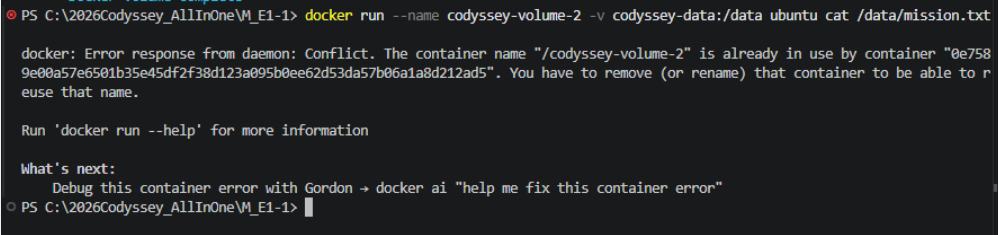

#### 원인 분석

docker run은 새로운 컨테이너를 생성한다.
이미 존재하는 컨테이너 이름은 중복 사용할 수 없다.

#### 해결 방법

```powershell
docker start -a codyssey-volume-2
```

#### 해결 결과

```text
Codyssey Volume Persistence Test
Data preserved: True
Exited (0)
```

기존 컨테이너 및 Volume을 삭제하지 않고
저장 데이터를 정상적으로 확인하였다.


## 13. Git 및 GitHub

### Git 환경 확인

```powershell
git --version
git config user.name
git config user.email
git rev-parse --show-toplevel
git remote
```


### 프로젝트 파일 정리

.gitignore 파일을 생성하여 비밀번호,
API Key 및 불필요한 임시 파일의 관리 제외 규칙을 설정하였다.


### Git 버전 관리 절차

```text
Working Directory
    ↓ git add
Staging Area
    ↓ git commit
Local Repository
    ↓ git push
GitHub Remote Repository
```

GitHub 원격 저장소 연결 및 최초 업로드를 완료하였다. 상세 결과는 18~22절에 기록하였다.

## 14. 학습 내용 및 향후 활용 계획

이번 실습을 통해 Linux 명령어, Docker 이미지와 컨테이너,
웹 서버 구축 및 데이터 저장 방식의 기본 개념을 학습하였다.

특히 Docker를 이용하면 개발 환경을 일관되게 구성하고,
동일한 이미지를 기반으로 여러 실행 환경을 구축할 수 있다.

향후 제조 현장의 AI Agent 개발에 다음과 같이 활용할 계획이다.

- 공작기계 주축 진동 분석 프로그램 개발
- FFT 및 베어링 결함 분석 서비스 구축
- FastAPI 기반 AI Agent 컨테이너화
- Bind Mount를 활용한 소스코드 개발
- Volume을 활용한 분석 데이터 저장
- GitHub 기반 소스코드 버전 관리

---

## 15. GitHub 저장소 구축 및 보안 점검

### GitHub 저장소

- Repository: M_E1-1
- Owner: cody26jade
- Branch: main
- Visibility requirement: Public
- Repository URL: https://github.com/cody26jade/M_E1-1

### Git 저장소 초기화

```powershell
git init -b main
git branch --show-current
git status --short
```

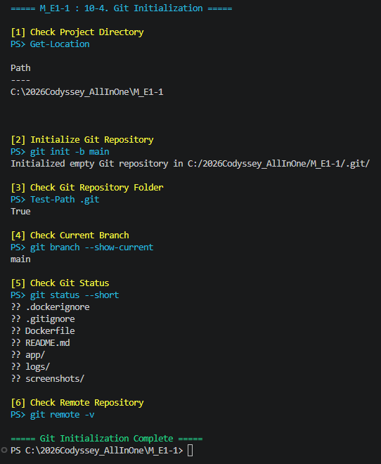

### GitHub 원격 저장소 연결

```powershell
git remote add origin https://github.com/cody26jade/M_E1-1.git
git remote -v
git remote get-url origin
git ls-remote origin
```

### 원격 저장소 연결 결과

| 검증 항목 | 결과 |
|---|---|
| Origin registration | Success |
| URL verified | True |
| GitHub access verified | True |
| Branch | main |

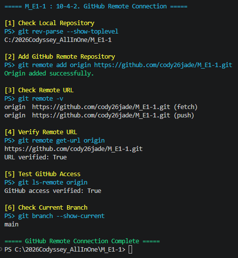

### 업로드 전 보안 점검

코디세이 동료평가를 위해 GitHub 저장소는
Public으로 제출하는 것을 원칙으로 한다.

공개 저장소에 API Key, 비밀번호 및 개인정보가
포함되지 않도록 업로드 전에 점검하였다.

```powershell
git ls-files --others --exclude-standard
```

### 자동 보안 점검 결과

| 점검 항목 | 점검 당시 결과 |
|---|---:|
| 업로드 대상 파일 | 29 |
| 스크린샷 | 17 |
| 실행 로그 | 7 |
| 기타 프로젝트 파일 | 5 |
| 민감정보 의심 파일명 | 0 |
| 비밀정보 패턴 검출 | 0 |

위 수치는 최초 자동 보안 점검 시점의 결과이며,
이후 증빙 파일 추가에 따라 전체 파일 수는 변경될 수 있다.

자동 검사만으로 모든 민감정보를 확인할 수 없으므로
공개 전 스크린샷과 로그를 별도로 검토해야 한다.


## 16. 프로젝트 재현 방법

본 프로젝트는 다른 개발자 및 동료평가자가
동일한 웹 서버 실행 환경을 구축할 수 있도록 구성하였다.

### 16.1 필수 설치 프로그램

- Git
- Docker Desktop 또는 Docker Engine
- 웹브라우저
- Visual Studio Code (권장)

Windows 환경에서는 Docker Desktop을 실행하고
Docker Engine이 정상적으로 작동하는지 확인한다.

```powershell
git --version
docker --version
docker info
```

### 16.2 GitHub 저장소 복제

GitHub 업로드가 완료된 후 다음 명령어를 실행한다.

```powershell
git clone https://github.com/cody26jade/M_E1-1.git
cd M_E1-1
```

### 16.3 Docker 이미지 빌드

```powershell
docker build -t codyssey-web:v1 .
```

### 16.4 NGINX 설정 확인

```powershell
docker run --rm codyssey-web:v1 nginx -t
```

### 16.5 웹 서버 실행

30001 포트가 사용 중이지 않은지 확인한 후 실행한다.

```powershell
docker run -d --name codyssey-review -p 127.0.0.1:30001:80 codyssey-web:v1
```

### 16.6 웹브라우저 접속

http://localhost:30001

### 16.7 웹 서버 응답 확인

```powershell
docker ps
(Invoke-WebRequest -Uri http://localhost:30001 -UseBasicParsing).StatusCode
```

예상 HTTP 응답 코드: 200

### 16.8 실습 종료

```powershell
docker stop codyssey-review
docker rm codyssey-review
```

위 명령어는 동료평가용 컨테이너만 중지하고 삭제한다.

## 17. 최초 제출 체크리스트

- [x] 개발 환경 구축
- [x] Linux 기본 명령어 및 파일 권한 실습
- [x] Docker 기본 실행
- [x] Docker 컨테이너 생명주기 실습
- [x] Docker 운영 및 관리
- [x] Dockerfile 및 이미지 빌드
- [x] NGINX 웹 서버 및 포트 매핑
- [x] Bind Mount 실습
- [x] Docker Volume 실습
- [x] Troubleshooting 사례 정리
- [x] Git 저장소 초기화
- [x] GitHub 원격 저장소 연결
- [x] 자동 보안 점검
- [x] 스크린샷 및 로그 수동 보안 점검
- [x] Git Add 및 Commit
- [x] GitHub Push
- [x] Public 저장소 확인
- [x] 최종 제출 검증

---

**2026 Codyssey AI All-in-One | M_E1-1**

## 18. Git Add 및 Commit 수행 결과

### 최초 Commit

| 항목 | 결과 |
|---|---|
| Commit Hash | a3ad338 |
| Commit Message | Initial commit: M_E1-1 mission |
| Staged files | 31 |
| Tracked files | 31 |
| Insertions | 1185 |
| Working tree clean | True |

### 주요 명령어

```powershell
git add .
git commit -m "Initial commit: M_E1-1 mission"
git log -1 --oneline
git status
```

### 실습 증빙


## 19. GitHub 인증 오류 해결

### 발생 오류

GitHub Push 과정에서 HTTP 403 오류가 발생하였다.

### 원인

기존 개인 GitHub 계정의 인증 정보가 사용되어
교육용 GitHub 저장소에 대한 쓰기 권한이 없었다.

Public 저장소는 누구나 읽을 수 있지만
쓰기 권한은 별도로 필요하다.

### 해결 방법

VS Code의 GitHub 로그인 계정을 정리하고
현재 프로젝트의 Git 인증 계정을 설정하였다.

```powershell
git config --local credential.https://github.com.username cody26jade
git config --local credential.https://github.com.useHttpPath true
git push -u origin main
```

브라우저 인증을 완료한 후 Push에 성공하였다.

### 검증 결과

- GitHub Push: 성공
- Local / Remote Commit 일치: True
- GitHub 저장소 공개 상태: Public
- Working tree: clean


## 20. 포트 충돌 오류 해결

### 발생 오류

재현성 검증용 컨테이너 실행 중
30003 포트 충돌이 발생하였다.

```text
Bind for 127.0.0.1:30003 failed:
port is already allocated
```

### 원인

기존 Bind Mount 실습용 컨테이너인
codyssey-bind가 30003 포트를 사용하고 있었다.

### 해결 방법

기존 컨테이너를 중지하지 않고
Docker의 자동 포트 할당 기능을 사용하였다.

```powershell
docker ps
Get-NetTCPConnection -LocalPort 30003 -State Listen
docker run -d --name review-test -p 127.0.0.1::80 codyssey-review:20261114-165542
docker port review-test 80/tcp
```

위 명령어의 review-test는 실행 방법을 설명하기 위한 예시 이름이다.

### 실제 검증 결과

| 컨테이너 | 호스트 포트 |
|---|---:|
| codyssey-web-1 | 30001 |
| codyssey-web-2 | 30002 |
| codyssey-bind | 30003 |
| codyssey-review-fix-20261114-165754 | 53783 |

자동 할당 포트는 실행 환경에 따라 달라질 수 있다.


## 21. 최종 재현성 검증

GitHub 공개 저장소를 별도의 임시 폴더에 복제하고
Docker 이미지를 다시 빌드하여 웹 서버를 실행하였다.

### 검증 결과

| 검증 항목 | 결과 |
|---|---|
| GitHub Clone | PASS |
| Required Files | PASS |
| Docker Image Build | PASS |
| NGINX Configuration | PASS |
| Automatic Port Allocation | PASS |
| Container Running | PASS |
| HTTP Status 200 | PASS |
| HTML SHA256 Match | PASS |

### 실제 검증 환경

- GitHub Commit: 6947c22
- Docker Image: codyssey-review:20261114-165542
- Automatically Assigned Port: 53783
- HTTP Status: 200
- HTML Content Matched: True

원본 HTML 파일과 웹 서버에서 다운로드한 HTML 파일의
SHA256 해시값을 비교하여 파일 내용의 동일성을 확인하였다.

이번 검증은 동일 PC의 별도 복제 폴더에서 수행하였다.


## 22. 최종 수행 결과

### 미션 수행 체크리스트

- [x] 개발 환경 구축
- [x] Linux 기본 명령어 실습
- [x] Linux 파일 및 폴더 권한 실습
- [x] Docker 기본 실행
- [x] Docker 컨테이너 생명주기 실습
- [x] Docker 이미지 및 컨테이너 관리
- [x] Dockerfile 작성 및 이미지 빌드
- [x] NGINX 웹 서버 구축
- [x] Port Mapping 실습
- [x] Bind Mount 실습
- [x] Docker Volume 영속성 검증
- [x] Git 저장소 초기화
- [x] Git Add 및 Commit
- [x] GitHub Public 저장소 업로드
- [x] 오류 원인 분석 및 해결
- [x] GitHub Clone 및 재현성 검증
- [x] HTTP 응답 및 HTML 무결성 검증
- [x] 최종 증빙 파일 추가 Commit 및 Push

### 제출 저장소

https://github.com/cody26jade/M_E1-1

### 학습 결과

Linux, Docker, NGINX, Git 및 GitHub를 활용하여
개발 환경을 직접 구축하고 운영하는 과정을 학습하였다.

실습 중 발생한 오류를 분석하고 해결하면서
개발 환경의 구성 원리와 문제 해결 방법을 이해하였다.

향후 제조 현장의 진동 데이터 분석 및 AI Agent 개발에
이번 미션에서 구축한 개발 환경을 활용할 예정이다.


## 23. 실습 증빙 자료

현재 프로젝트에 실제로 저장된 스크린샷을 기준으로 정리하였다.

일부 오류 해결 과정은 별도의 화면 캡처 없이 진행하였으며,
해당 내용은 본문의 오류 원인 및 해결 방법에 기록하였다.

- 저장된 스크린샷: 26개

| No. | 증빙 파일 |
|---:|---|
| 1 | [01. Development Environment.png](screenshots/01.%20Development%20Environment.png) |
| 2 | [02_linux_permission.png](screenshots/02_linux_permission.png) |
| 3 | [03_docker_basic.png](screenshots/03_docker_basic.png) |
| 4 | [04_docker_lifecycle.png](screenshots/04_docker_lifecycle.png) |
| 5 | [05_docker_operation.png](screenshots/05_docker_operation.png) |
| 6 | [06_docker_build.png](screenshots/06_docker_build.png) |
| 7 | [07_error_connection_refused.png](screenshots/07_error_connection_refused.png) |
| 8 | [07_port_mapping.png](screenshots/07_port_mapping.png) |
| 9 | [07_web_browser.png](screenshots/07_web_browser.png) |
| 10 | [08_bind_mount.png](screenshots/08_bind_mount.png) |
| 11 | [09_error_name_conflict.png](screenshots/09_error_name_conflict.png) |
| 12 | [09_error_resolved.png](screenshots/09_error_resolved.png) |
| 13 | [10-1_git_environment.png](screenshots/10-1_git_environment.png) |
| 14 | [10-2_project_organization.png](screenshots/10-2_project_organization.png) |
| 15 | [10-3_readme_creation.png](screenshots/10-3_readme_creation.png) |
| 16 | [10-4_git_initialization.png](screenshots/10-4_git_initialization.png) |
| 17 | [10-4-2_github_remote.png](screenshots/10-4-2_github_remote.png) |
| 18 | [10-5-1_security_check.png](screenshots/10-5-1_security_check.png) |
| 19 | [10-5-2_readme_final.png](screenshots/10-5-2_readme_final.png) |
| 20 | [10-5-3_git_commit(1).png](screenshots/10-5-3_git_commit%281%29.png) |
| 21 | [10-5-3_git_commit(2).png](screenshots/10-5-3_git_commit%282%29.png) |
| 22 | [10-5-4_github_public.png](screenshots/10-5-4_github_public.png) |
| 23 | [10-5-4_github_push.png](screenshots/10-5-4_github_push.png) |
| 24 | [10-6-1_reproduction_test.png](screenshots/10-6-1_reproduction_test.png) |
| 25 | [10-6-1_review_browser.png](screenshots/10-6-1_review_browser.png) |

### 추가 실습 증빙 이미지

#### 10-3_readme_creation

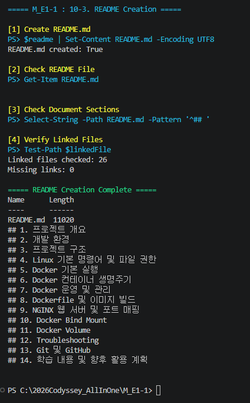

#### 10-5-2_readme_final

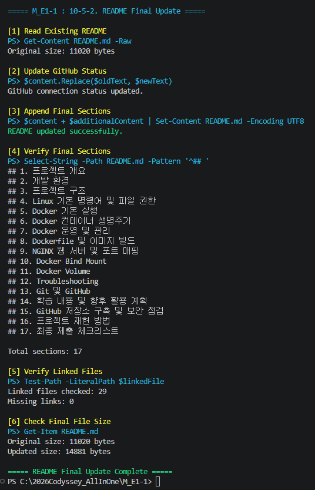

#### 10-5-4_github_public

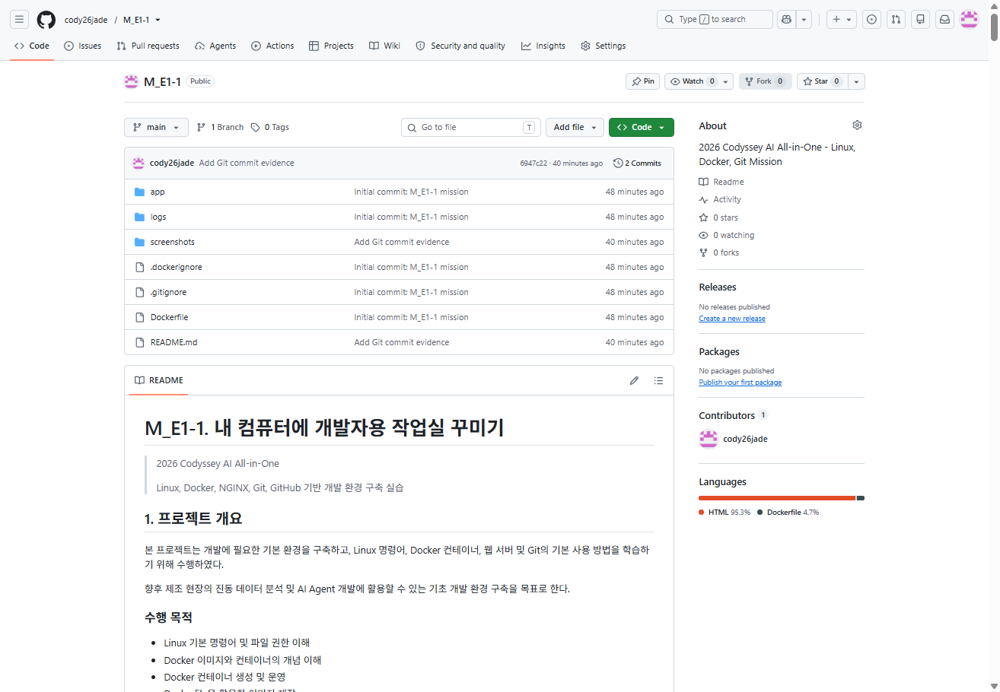

#### 10-5-4_github_push

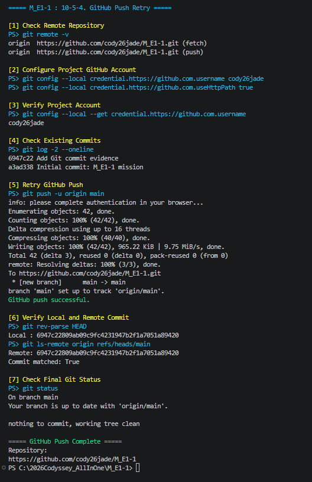

#### 10-6-1_reproduction_test

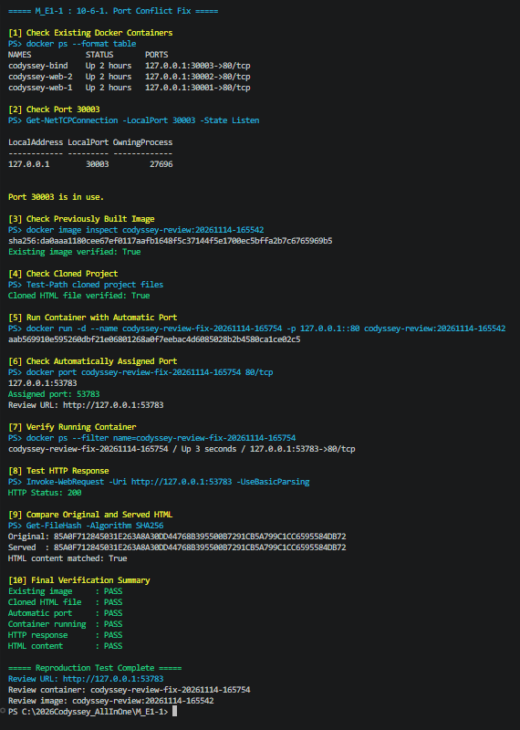

#### 10-6-1_review_browser

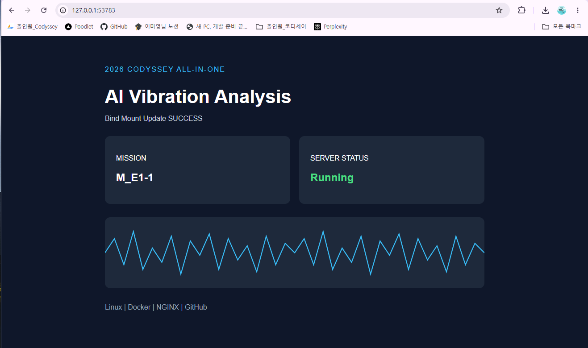

추가 증빙: [10-6-2_readme_final.png](screenshots/10-6-2_readme_final.png)

---

## 24. 네이토 사전평가 대응 및 보완 결과

### 24.1 보완 목적

최초 미션 완료 후 네이토 AI 사전평가를 수행하였다.

- 최초 평가: 11/18 항목 통과
- 최초 점수: 61%
- 보완 실습 일자: 2026-11-14
- 보완 목표: 18개 평가 항목 전체에 대한 설명 및 실행 증빙 확보

최초 제출에서는 스크린샷 중심으로 증빙을 구성하였다.
이번 보완에서는 실제 실행 명령어, 터미널 출력,
재현 가능한 스크립트 및 기술 개념 설명을 추가하였다.

아래 결과는 실제 보완 실습에서 확보한 결과이다.
명령어 사용 예시는 실제 실행 결과와 구분하여 표시하였다.

### 24.2 Linux 파일 및 디렉터리 관리

관련 평가 항목: #01

Ubuntu 컨테이너 내부에서 독립적인 임시 디렉터리를 생성하여
파일 생성, 복사, 이동, 삭제를 순서대로 검증하였다.

실행 명령어:

```powershell
$scriptDir = (Resolve-Path ".\scripts").Path

docker run --rm --mount "type=bind,source=$scriptDir,target=/scripts,readonly" ubuntu:latest bash /scripts/R02_linux_file_operations.sh
```

실습 명령어 및 검증 내용:

| 명령어 | 수행 내용 |
|---|---|
| mkdir | source 및 target 디렉터리 생성 |
| touch | mission.txt 생성 |
| echo | 파일에 테스트 내용 기록 |
| cat | 파일 내용 확인 |
| cp | mission.txt를 copy.txt로 복사 |
| cmp | 원본과 복사본 비교 |
| mv | copy.txt를 moved.txt로 이동 |
| ls | 파일 및 디렉터리 상태 확인 |
| rm | 실습 파일 삭제 |
| rmdir | 비어 있는 실습 디렉터리 삭제 |
| test | 파일 생성 및 삭제 상태 검증 |

실제 최종 출력:

```text
PASS: ALL LINUX FILE OPERATIONS COMPLETED
```

전체 명령어 및 실제 실행 결과:

- [R02 Linux 파일 조작 실행 로그](logs/R02_linux_file_operations.txt)
- [R02 재현용 스크립트](scripts/R02_linux_file_operations.sh)

### 24.3 Linux 파일 권한 및 chmod

관련 평가 항목: #02, #15

Linux의 기본 파일 권한은 소유자(user), 그룹(group),
기타 사용자(other)로 구분된다.

| 권한 | 문자 | 숫자 |
|---|---|---:|
| 읽기 | r | 4 |
| 쓰기 | w | 2 |
| 실행 | x | 1 |
| 권한 없음 | - | 0 |

각 사용자 범주의 권한 숫자는 4, 2, 1의 합으로 계산한다.

| 숫자 | 권한 | 계산 |
|---:|---|---|
| 0 | --- | 0 |
| 1 | --x | 1 |
| 2 | -w- | 2 |
| 3 | -wx | 2+1 |
| 4 | r-- | 4 |
| 5 | r-x | 4+1 |
| 6 | rw- | 4+2 |
| 7 | rwx | 4+2+1 |

대표적인 권한 설정:

| chmod | 소유자 | 그룹 | 기타 사용자 | 의미 |
|---|---|---|---|---|
| 644 | rw- | r-- | r-- | 일반 문서 |
| 755 | rwx | r-x | r-x | 실행 프로그램 |
| 600 | rw- | --- | --- | 개인 파일 |
| 700 | rwx | --- | --- | 개인 실행 파일 |
| 777 | rwx | rwx | rwx | 모든 사용자에게 모든 권한 |

777은 모든 사용자에게 쓰기 권한까지 허용하므로
일반적인 운영 환경에서는 최소 권한 원칙에 따라 사용을 제한한다.

디렉터리에서 r은 목록 읽기, w는 항목 생성 및 삭제,
x는 디렉터리 내부 경로 탐색을 의미한다.
실제 접근 가능 여부에는 다른 권한 및 상위 경로도 영향을 준다.

실행 명령어:

```powershell
$scriptDir = (Resolve-Path ".\scripts").Path

docker run --rm --mount "type=bind,source=$scriptDir,target=/scripts,readonly" ubuntu:latest bash /scripts/R03_linux_permissions.sh
```

실제 실습에서 확인한 권한 변화:

| 실행 명령어 | 실행 후 권한 |
|---|---|
| chmod 644 permission_test.sh | -rw-r--r-- |
| chmod 755 permission_test.sh | -rwxr-xr-x |
| chmod 600 permission_test.sh | -rw------- |
| chmod u+x permission_test.sh | -rwx------ |
| chmod g+rx,o+rx permission_test.sh | -rwxr-xr-x |
| chmod a-x permission_test.sh | -rw-r--r-- |

755 및 700 설정 후 스크립트 실행을 확인하였다.

실제 최종 출력:

```text
PASS: ALL LINUX PERMISSION TESTS COMPLETED
```

본 실습은 컨테이너의 root 사용자 환경에서 수행하였다.
따라서 권한 비트 변경과 실행 가능 여부를 검증한 것이며,
일반 사용자별 접근 제한을 모두 검증한 것은 아니다.

- [R03 chmod 실행 전후 ls -l 전체 로그](logs/R03_linux_permissions.txt)
- [R03 재현용 스크립트](scripts/R03_linux_permissions.sh)

### 24.4 Docker 설치 및 기본 실행

관련 평가 항목: #03, #04, #05

실제 실행 결과:

```text
> docker --version
Docker version 29.9.2, build a82e528
```

```text
> docker run --rm --pull=never hello-world:latest

Hello from Docker!
This message shows that your installation appears to be working correctly.
```

hello-world 이미지가 이미 설치되어 있었으므로
--pull=never 옵션을 사용하여 기존 이미지로 실행하였다.

- --rm: 실행 종료 후 해당 컨테이너 자동 삭제
- --pull=never: 이미지 다운로드 없이 로컬 이미지 사용
- hello-world:latest: 실행 대상 이미지와 태그

실제 docker images 출력:

```text
IMAGE                             ID             DISK USAGE   CONTENT SIZE
codyssey-review:20261114-165542   da0aaa1180ce       93.7MB         26.4MB
codyssey-web:v1                   3af2f6904b6b       93.7MB         26.4MB
hello-world:latest                cf1b20a0c89a       25.9kB         9.49kB
ubuntu:latest                     065aa8626841        163MB         45.9MB
```

위 표는 실제 출력의 주요 열을 발췌한 것이다.

docker ps는 실행 중인 컨테이너를 표시하며,
docker ps -a는 종료된 컨테이너를 포함하여 표시한다.

보완 검증 시점의 컨테이너는 총 8개였으며,
이 중 4개가 실행 중이었다.

- [R04 Docker 기본 명령어 전체 실행 로그](logs/R04_docker_basic_commands.txt)

### 24.5 Dockerfile 및 이미지 빌드

관련 평가 항목: #06

실제 Dockerfile:

```dockerfile
FROM nginx:alpine

COPY app/index.html /usr/share/nginx/html/index.html

EXPOSE 80

CMD ["nginx", "-g", "daemon off;"]
```

이미지 빌드 명령어:

```powershell
docker build -t codyssey-web:v1 .
```

| 명령어 및 옵션 | 의미 |
|---|---|
| docker build | Dockerfile을 기반으로 이미지 생성 |
| -t | 이미지 이름 및 태그 지정 |
| codyssey-web:v1 | 이미지 이름 codyssey-web, 태그 v1 |
| . | 현재 디렉터리를 빌드 컨텍스트로 지정 |
| FROM | 기반 이미지 지정 |
| COPY | 빌드 컨텍스트의 파일을 이미지에 복사 |
| EXPOSE | 컨테이너가 사용할 포트 문서화 |
| CMD | 컨테이너의 기본 실행 명령 지정 |

EXPOSE 80만으로 호스트에 포트가 공개되는 것은 아니다.
호스트에서 접근하려면 실행 시 포트 매핑 등을 설정해야 한다.

최초 빌드 로그의 실제 출력 발췌:

```text
#6 [2/2] COPY app/index.html /usr/share/nginx/html/index.html
#6 DONE 0.1s
#7 naming to docker.io/library/codyssey-web:v1 done
#7 DONE 0.9s
```

보완 실습에서는 기존 빌드 로그와 이미지 정보를 재검증하였다.

- [최초 이미지 빌드 로그](logs/06_docker_build.txt)
- [NGINX 설정 검사 로그](logs/06_nginx_test.txt)
- [R05 Docker 심화 검증 로그](logs/R05_docker_advanced_verification.txt)

### 24.6 Image와 Container의 차이

관련 평가 항목: #12

Image는 애플리케이션과 실행 환경을 포함한 템플릿이다.
Container는 이미지를 기반으로 생성한 실행 인스턴스이다.

이미지의 기존 레이어는 읽기 전용이며,
컨테이너에는 개별 쓰기 가능 레이어가 추가된다.

```text
Dockerfile
    |
    | docker build
    v
codyssey-web:v1 (Image)
    |
    | docker run
    +-- codyssey-web-1 (Container)
    +-- codyssey-web-2 (Container)
    +-- codyssey-bind  (Container)
```

하나의 이미지에서 여러 컨테이너를 생성할 수 있으며,
각 컨테이너의 실행 상태와 쓰기 가능 레이어는 독립적이다.

컨테이너를 중지했다가 시작하면 기존 쓰기 레이어는 유지되지만,
컨테이너를 삭제하면 해당 레이어의 데이터는 사라진다.

컨테이너 내부에서 파일을 변경해도 원본 이미지가
자동으로 변경되는 것은 아니다.

새 이미지를 생성하는 방법의 예:

```powershell
docker commit example-container codyssey-web:v2
```

위 명령어는 개념 설명용 예시이며 이번 보완 실습에서
실행한 명령어는 아니다. 마운트된 데이터는 commit에 포함되지 않는다.

일반적인 개발 및 배포에서는 Dockerfile을 수정한 뒤
docker build를 실행하는 방법이 재현성과 버전 관리에 유리하다.

### 24.7 Network Namespace 및 Port Mapping

관련 평가 항목: #07, #11, #13

Network Namespace는 Linux 커널의 네트워크 격리 기능이다.

각 네임스페이스는 독립적인 네트워크 인터페이스,
IP 주소, 라우팅 테이블, 소켓 및 포트 공간을 가질 수 있다.

기본 bridge 네트워크를 사용하는 Docker 컨테이너는
독립적인 네트워크 네임스페이스를 사용한다.

따라서 여러 컨테이너가 동일한 내부 포트 80에서
웹 서버를 실행해도 서로 충돌하지 않는다.

실제 네트워크 검증 명령어:

```powershell
docker network ls

docker inspect codyssey-web-1 codyssey-web-2 codyssey-bind --format "{{.Name}} | {{range .NetworkSettings.Networks}}{{.IPAddress}}{{end}}"

docker exec codyssey-web-1 readlink /proc/self/ns/net
docker exec codyssey-web-2 readlink /proc/self/ns/net
docker exec codyssey-bind readlink /proc/self/ns/net
```

실제 검증 결과:

| 컨테이너 | 내부 IP | 내부 포트 | 호스트 포트 | Namespace ID |
|---|---|---:|---:|---:|
| codyssey-web-1 | 172.17.0.2 | 80 | 30001 | 4026532380 |
| codyssey-web-2 | 172.17.0.3 | 80 | 30002 | 4026532456 |
| codyssey-bind | 172.17.0.4 | 80 | 30003 | 4026532532 |

실제 네임스페이스 확인 출력:

```text
net:[4026532380]
net:[4026532456]
net:[4026532532]
```

위 결과는 세 컨테이너가 서로 다른 네트워크
네임스페이스를 사용하고 있음을 보여준다.

Windows의 Docker Desktop은 Linux 컨테이너를
Linux 가상화 환경에서 실행한다.

컨테이너 내부의 네트워크와 Windows 호스트의 네트워크는
분리되어 있으므로 이번 실습에서는 포트 매핑을 이용해
Windows 웹브라우저에서 컨테이너의 NGINX에 접근하였다.

```text
Windows Host                  Linux Container

127.0.0.1:30001 -----------> web-1 :80
127.0.0.1:30002 -----------> web-2 :80
127.0.0.1:30003 -----------> bind  :80
```

Docker 실행 명령어 예:

```powershell
docker run -d --name codyssey-review -p 127.0.0.1:30001:80 codyssey-web:v1
```

| 옵션 | 의미 |
|---|---|
| -d | 백그라운드 실행 |
| --name | 컨테이너 이름 지정 |
| -p | 호스트와 컨테이너 포트 연결 |
| 127.0.0.1 | 호스트의 로컬 루프백 주소 |
| 30001 | 호스트 포트 |
| 80 | 컨테이너 내부 포트 |

다른 포트 사용 예:

```powershell
docker run -d --name codyssey-example -p 127.0.0.1:30010:80 codyssey-web:v1
```

자동 포트 할당 예:

```powershell
docker run -d --name codyssey-auto -p 127.0.0.1::80 codyssey-web:v1

docker port codyssey-auto 80/tcp
```

위 예시를 실행할 때는 기존 컨테이너 이름 및 포트
사용 여부를 먼저 확인해야 한다.

호스트에서만 접근할 때는 127.0.0.1에 바인딩한다.
외부 접근이 필요한 경우에는 별도의 보안 설정을 고려한다.

동일한 Docker 네트워크에 연결된 컨테이너끼리 통신할 때는
호스트 포트 매핑이 반드시 필요한 것은 아니다.

### 24.8 HTTP 응답 실제 검증

관련 평가 항목: #07

실제 실행 명령어:

```powershell
curl.exe --fail --silent --show-error --max-time 10 -i http://127.0.0.1:30001/

curl.exe --fail --silent --show-error --max-time 10 -i http://127.0.0.1:30002/

curl.exe --fail --silent --show-error --max-time 10 -i http://127.0.0.1:30003/
```

실제 응답 상태:

| 호스트 포트 | HTTP 응답 |
|---:|---|
| 30001 | HTTP/1.1 200 OK |
| 30002 | HTTP/1.1 200 OK |
| 30003 | HTTP/1.1 200 OK |

30003 포트에서는 Bind Mount로 연결한
웹페이지의 변경 내용도 확인하였다.

HTTP 헤더 및 전체 HTML 응답은 다음 로그에 포함되어 있다.

- [R05 HTTP 전체 응답 및 네트워크 검증](logs/R05_docker_advanced_verification.txt)

### 24.9 절대경로와 상대경로 선택 기준

관련 평가 항목: #14

절대경로는 파일시스템의 루트 또는 드라이브에서 시작하는 경로이다.
상대경로는 현재 작업 디렉터리를 기준으로 해석되는 경로이다.

| 환경 | 절대경로 | 상대경로 |
|---|---|---|
| Windows | C:\project\app\index.html | .\app\index.html |
| Linux | /tmp/project/app/test.txt | ./app/test.txt |

선택 기준:

| 상황 | 권장 방식 | 이유 |
|---|---|---|
| 고정 운영 서버 | 절대경로 또는 환경변수 | 위치를 명확하게 관리 |
| GitHub 공동 개발 | 상대경로 | 설치 경로가 달라도 재사용 가능 |
| Docker Bind Mount | 상대경로를 절대경로로 변환 | 명확한 호스트 경로 지정 |
| Dockerfile COPY | 빌드 컨텍스트 기준 상대경로 | 프로젝트 이식성 확보 |

Docker Bind Mount는 호스트의 실제 파일 또는
디렉터리를 컨테이너 내부 경로에 연결한다.

Windows의 고정 절대경로 사용 예:

```powershell
docker run -d --name codyssey-absolute -p 127.0.0.1::80 --mount "type=bind,source=C:\2026Codyssey_AllInOne\M_E1-1\app,target=/usr/share/nginx/html,readonly" codyssey-web:v1
```

이식성을 고려한 권장 예:

```powershell
$appPath = (Resolve-Path ".\app").Path

docker run -d --name codyssey-relative -p 127.0.0.1::80 --mount "type=bind,source=$appPath,target=/usr/share/nginx/html,readonly" codyssey-web:v1
```

위 두 명령어는 경로 선택 기준을 설명하기 위한 예시이다.

Resolve-Path를 사용하면 현재 프로젝트 기준의 상대경로를
실제 절대경로로 변환하여 Docker에 전달할 수 있다.

실제 Windows 경로 검증:

```text
ABSOLUTE PATH: C:\2026Codyssey_AllInOne\M_E1-1\app\index.html
RELATIVE PATH: .\app\index.html

ABSOLUTE HASH: A15EBBC92FF67E7E524B2A54D79DC852C2477AE4635A0456BFDC847975407ED9
RELATIVE HASH: A15EBBC92FF67E7E524B2A54D79DC852C2477AE4635A0456BFDC847975407ED9

PASS: Windows absolute and relative paths verified
```

실제 Linux 경로 검증:

```text
+ realpath /tmp/codyssey-r06/app/test.txt
/tmp/codyssey-r06/app/test.txt

+ realpath ./app/test.txt
/tmp/codyssey-r06/app/test.txt

+ test /tmp/codyssey-r06/app/test.txt -ef ./app/test.txt
PASS: Both Linux paths identify the same file

PASS: Parent directory path verified
PASS: ALL LINUX PATH TESTS COMPLETED
```

- [R06 Git 및 Windows 경로 검증](logs/R06_git_project_paths.txt)
- [R06B Linux 경로 재검증](logs/R06B_linux_paths_verified.txt)
- [R06 Linux 재현용 스크립트](scripts/R06_linux_paths.sh)

### 24.10 Bind Mount와 Volume 선택 기준

관련 평가 항목: #08, #17

| 구분 | Bind Mount | Named Volume |
|---|---|---|
| 관리 주체 | 호스트 파일시스템 | Docker |
| 저장 위치 | 사용자가 지정한 호스트 경로 | Docker 관리 영역 |
| 호스트 직접 편집 | 편리함 | 일반적으로 컨테이너를 통해 접근 |
| 경로 의존성 | 호스트 경로에 의존 | 상대적으로 낮음 |
| 권장 용도 | 소스코드 및 설정 파일 개발 | DB 및 영속 데이터 저장 |

Bind Mount는 개발 중 HTML이나 Python 소스코드를
수정하고 즉시 반영할 때 유용하다.

Named Volume은 데이터베이스, 분석 결과,
장기 보존 데이터 등을 관리할 때 유용하다.

Named Volume도 별도로 삭제하면 데이터가 사라질 수 있으므로
중요 데이터는 별도 백업이 필요하다.

실제 검증 결과:

- Bind Mount 대상: app 디렉터리
- 컨테이너 연결 경로: /usr/share/nginx/html
- 마운트 모드: 읽기 전용
- 호스트 변경 내용: 웹페이지 반영 확인
- Named Volume: codyssey-data
- 기존 데이터: mission.txt, 33 bytes
- 새로운 컨테이너에서 기존 데이터 읽기 성공

최초 Volume 실습 결과:

```text
Data preserved: True
```

- [Bind Mount 최초 검증](logs/08_bind_mount.txt)
- [Volume 최초 검증](logs/09_volume.txt)
- [R05 Bind Mount 및 Volume 재검증](logs/R05_docker_advanced_verification.txt)

### 24.11 Git 설정 및 프로젝트 구조 설계

관련 평가 항목: #09, #10

실제 Git 설정 확인:

```text
> git --version
git version 2.56.0.windows.4

> git config user.name
cody26jade

> git branch --show-current
main

> git remote -v
origin https://github.com/cody26jade/M_E1-1.git (fetch)
origin https://github.com/cody26jade/M_E1-1.git (push)
```

git config user.email 명령어를 이용하여
이메일 설정 여부도 확인하였다.

```text
GIT USER NAME: cody26jade
GIT USER EMAIL: Configured (value withheld)
PASS: Git identity configured
```

공개 저장소의 개인정보 보호를 위해
실제 이메일 주소는 문서와 신규 검증 로그에 출력하지 않았다.

Git 설정의 목적:

- user.name: 커밋 작성자 이름 설정
- user.email: 커밋 작성자 이메일 설정
- remote: 원격 저장소 연결 정보 관리
- main: 기본 작업 브랜치

보완 후 프로젝트 구조:

```text
M_E1-1/
├── app/
│   └── index.html
├── logs/
├── screenshots/
├── scripts/
│   ├── R02_linux_file_operations.sh
│   ├── R03_linux_permissions.sh
│   └── R06_linux_paths.sh
├── .dockerignore
├── .gitignore
├── Dockerfile
└── README.md
```

구조 설계 이유:

| 구성 | 설계 이유 |
|---|---|
| app | 실행 소스코드와 증빙 자료 분리 |
| logs | 실제 실행 결과의 추적 및 검증 |
| screenshots | 시각적인 실습 증빙 보존 |
| scripts | 동일한 Linux 실습을 반복 재현 |
| Dockerfile | 이미지 제작 절차를 코드로 관리 |
| .dockerignore | 불필요한 빌드 컨텍스트 감소 |
| .gitignore | 비밀정보 및 임시 파일의 추적 방지 |
| README.md | 실행 방법과 기술 개념 및 평가 근거 제공 |

프로젝트를 복제한 평가자는 실행 소스, 재현용 스크립트,
실행 로그를 각각 독립적으로 확인할 수 있다.

- [R06 Git 및 프로젝트 구조 검증](logs/R06_git_project_paths.txt)
- [R09 최종 증빙 및 Git 설정 확인](logs/R09_final_evidence_inventory.txt)

### 24.12 포트 충돌 원인 분석 및 해결

관련 평가 항목: #16, #18

2026-11-14 보완 실습에서 포트 충돌을 의도적으로 재현하였다.

가설:

기존 codyssey-bind 컨테이너가 호스트의 30003 포트를
사용하고 있으므로 동일한 포트를 사용하는 새로운
컨테이너는 정상적으로 시작할 수 없다.

확인 명령어:

```powershell
docker ps

Get-NetTCPConnection -LocalPort 30003 -State Listen

Get-Process -Id 27696
```

실제 확인 결과:

```text
LocalAddress LocalPort State  OwningProcess
127.0.0.1    30003     Listen 27696

Id    ProcessName
27696 com.docker.backend
```

PID는 실행 시점에 따라 변경될 수 있다.

실제 오류 발생 명령어:

```powershell
docker run -d --pull=never --name codyssey-r08-c2554a2a -p 127.0.0.1:30003:80 codyssey-web:v1
```

실제 오류 출력 발췌:

```text
Bind for 127.0.0.1:30003 failed: port is already allocated
EXPECTED FAILURE EXIT CODE: 125
PASS: Port conflict reproduced
```

해결 명령어:

```powershell
docker rm codyssey-r08-c2554a2a

docker run -d --pull=never --name codyssey-r08-c2554a2a -p 127.0.0.1::80 codyssey-web:v1

docker port codyssey-r08-c2554a2a 80/tcp
```

실제 해결 결과:

```text
127.0.0.1:52364
URL: http://127.0.0.1:52364/
HTTP STATUS: 200
PASS: Port conflict resolved using automatic port allocation
```

검증 종료 후 임시 컨테이너를 삭제하였다.

```powershell
docker rm -f codyssey-r08-c2554a2a
```

기존 컨테이너 8개 및 codyssey-data Volume은 보존하였다.

고정 포트가 반드시 필요한 경우에는 해당 포트를 사용 중인
자신의 컨테이너를 확인하고 중지한 뒤 사용할 수 있다.

예시:

```powershell
docker stop codyssey-bind
```

위 명령어는 해결 방법 설명용이며 R08에서는 실행하지 않았다.
Docker Desktop의 백엔드 프로세스를 강제로 종료하지 않았다.

- [R08 실제 포트 충돌 및 해결 로그](logs/R08_troubleshooting_verification.txt)

### 24.13 PowerShell과 Bash 명령어 전달 오류

관련 평가 항목: #18

R06 최초 실행에서 Windows PowerShell을 통해
복수의 Bash 명령어를 직접 전달하였다.

실제 결과:

```text
+ mkdir -p /tmp/codyssey-r06/app
+ echo Linux
Linux
Failed: False
```

종료 코드는 정상이었지만 전체 경로 검증 명령어가
실행되지 않았고 최종 성공 문구도 출력되지 않았다.

원인은 PowerShell 5.1과 Bash 사이의 중첩 따옴표
처리 및 명령어 전달 문제로 추정하였다.

해결 방법:

1. Bash 명령어를 별도의 .sh 파일로 작성
2. UTF-8 BOM 없음 및 LF 줄바꿈으로 저장
3. 스크립트 폴더를 읽기 전용 Bind Mount로 연결
4. Bash에서 스크립트 직접 실행
5. 종료 코드와 최종 성공 문구를 함께 검사

실제 재검증 결과:

```text
PASS: Both Linux paths identify the same file
PASS: Parent directory path verified
PASS: ALL LINUX PATH TESTS COMPLETED
PASS: Exit code and completion marker verified
```

단순히 프로세스 종료 코드가 0이라는 사실만으로
전체 실습 목적의 달성을 판단해서는 안 된다는 점을 확인하였다.

- [최초 R06 실행 로그](logs/R06_git_project_paths.txt)
- [수정 후 R06B 실행 로그](logs/R06B_linux_paths_verified.txt)

### 24.14 HTML 인코딩 및 데이터 무결성 검증

관련 평가 항목: #18

R05 HTTP 응답을 PowerShell에서 출력할 때
HTML 시작 부분의 일부 문자가 깨져 표시되었다.

원본 HTML의 인코딩과 HTTP 전송 데이터의
무결성을 확인하기 위해 추가 검증하였다.

실제 검사 결과:

```text
FILE: app/index.html
FILE SIZE: 2430 bytes
FIRST 8 BYTES: EF-BB-BF-3C-21-44-4F-43
UTF-8 BOM PRESENT: True
PASS: File is valid UTF-8
CONSOLE OUTPUT ENCODING: ks_c_5601-1987
```

EF BB BF는 UTF-8 BOM을 의미한다.

UTF-8 파일과 PowerShell 콘솔의 레거시 한글 인코딩 사이의
불일치를 깨진 문자의 유력한 원인으로 판단하였다.

원본 파일과 HTTP 다운로드 파일을 SHA256으로 비교하였다.

실제 결과:

```text
SOURCE SHA256: A15EBBC92FF67E7E524B2A54D79DC852C2477AE4635A0456BFDC847975407ED9

DOWNLOAD SHA256: A15EBBC92FF67E7E524B2A54D79DC852C2477AE4635A0456BFDC847975407ED9

PASS: HTTP response matches original HTML bytes
```

원본과 다운로드 파일이 일치하므로 HTTP 전송 과정에서
HTML 데이터가 손상되었다는 증거는 없었다.

이번 보완에서는 원인 분석과 검증만 수행하고
기존 HTML 파일을 변경하지 않았다.

- [R08 HTML 인코딩 및 SHA256 검증 로그](logs/R08_troubleshooting_verification.txt)

### 24.15 보완 실습 재현 방법

프로젝트 루트의 Windows PowerShell에서 실행한다.

```powershell
$scriptDir = (Resolve-Path ".\scripts").Path

docker run --rm --mount "type=bind,source=$scriptDir,target=/scripts,readonly" ubuntu:latest bash /scripts/R02_linux_file_operations.sh

docker run --rm --mount "type=bind,source=$scriptDir,target=/scripts,readonly" ubuntu:latest bash /scripts/R03_linux_permissions.sh

docker run --rm --mount "type=bind,source=$scriptDir,target=/scripts,readonly" ubuntu:latest bash /scripts/R06_linux_paths.sh
```

Docker Engine이 실행 중이어야 하며,
Ubuntu 이미지가 없는 경우 최초 실행 시 다운로드가 필요하다.

각 스크립트는 임시 컨테이너에서 실행되며
기존 컨테이너 및 Named Volume을 삭제하지 않는다.

### 24.16 보완 증빙 자료 관리

보완 작업에서 확보한 실행 로그:

| 로그 | 내용 |
|---|---|
| R02_linux_file_operations.txt | Linux 파일 관리 |
| R03_linux_permissions.txt | chmod 권한 변경 |
| R04_docker_basic_commands.txt | Docker 기본 실행 |
| R05_docker_advanced_verification.txt | 이미지, 네트워크, HTTP, Mount |
| R06_git_project_paths.txt | Git 및 경로 최초 검증 |
| R06B_linux_paths_verified.txt | Linux 경로 오류 수정 및 재검증 |
| R08_troubleshooting_verification.txt | 포트 충돌 및 인코딩 |
| R09_final_evidence_inventory.txt | 최종 증빙 및 Git 설정 점검 |

원본 실행 로그는 로컬 공통 로그 디렉터리에 보존한다.

공개 제출용 신규 로그에서 개인 Windows 사용자 경로는
필요한 경우 마스킹하며 실습 명령어와 검증 결과는 유지한다.

R06 최초 실행의 불완전한 결과도 삭제하지 않고 보존하였다.

### 24.17 Consolidated Execution Evidence

- [Actual execution evidence - Markdown](logs/REVISION_EVIDENCE.md)
- [Final evidence accuracy review](logs/R10_evidence_accuracy_review.txt)

The consolidated Markdown document contains actual execution logs,
including the original commands, outputs and verification results.

The individual source logs are retained.

The final review confirmed that network addresses, namespace IDs,
HTTP status codes, volume file size and build timings match
the recorded execution evidence.

Git attributes preserve LF line endings for Bash scripts.

## 25. 네이토 평가 항목별 증빙 대응표

최초 평가에서 확인한 18개 평가 항목을 기준으로
보완 설명 및 실제 실행 증빙을 연결하였다.

| 번호 | 평가 내용 | 최초 평가 | 보완 설명 | 실행 증빙 |
|---:|---|---|---|---|
| 01 | Linux 파일 생성, 복사, 이동, 삭제 | FAIL | 24.2 | [R02](logs/R02_linux_file_operations.txt) |
| 02 | chmod 실행 전후 권한 확인 | FAIL | 24.3 | [R03](logs/R03_linux_permissions.txt) |
| 03 | Docker 설치 및 버전 확인 | PASS | 24.4 | [R04](logs/R04_docker_basic_commands.txt) |
| 04 | hello-world 실행 | FAIL | 24.4 | [R04](logs/R04_docker_basic_commands.txt) |
| 05 | docker images 및 docker ps -a | FAIL | 24.4 | [R04](logs/R04_docker_basic_commands.txt) |
| 06 | Dockerfile 및 이미지 빌드 | PASS | 24.5 | [Build](logs/06_docker_build.txt), [R05](logs/R05_docker_advanced_verification.txt) |
| 07 | 포트 매핑 및 HTTP 접속 | PASS | 24.7~24.8 | [R05](logs/R05_docker_advanced_verification.txt) |
| 08 | Bind Mount 및 Volume 데이터 관리 | PASS | 24.10 | [R05](logs/R05_docker_advanced_verification.txt), [Volume](logs/09_volume.txt) |
| 09 | Git 설정 및 원격 저장소 | PASS | 24.11 | [R06](logs/R06_git_project_paths.txt), [R09](logs/R09_final_evidence_inventory.txt) |
| 10 | 프로젝트 디렉터리 구조 | PASS | 24.11 | [R06](logs/R06_git_project_paths.txt) |
| 11 | Docker 실행 명령어 및 옵션 | PASS | 24.7 | [R05](logs/R05_docker_advanced_verification.txt) |
| 12 | Image와 Container의 차이 | PASS | 24.6 | [R04](logs/R04_docker_basic_commands.txt) |
| 13 | Network Namespace 및 포트 매핑 | FAIL | 24.7 | [R05](logs/R05_docker_advanced_verification.txt) |
| 14 | 절대경로와 상대경로 선택 기준 | FAIL | 24.9 | [R06B](logs/R06B_linux_paths_verified.txt) |
| 15 | rwx 권한과 숫자 매핑 | FAIL | 24.3 | [R03](logs/R03_linux_permissions.txt) |
| 16 | 포트 충돌 확인 및 해결 | PASS | 24.12 | [R08](logs/R08_troubleshooting_verification.txt) |
| 17 | Bind Mount와 Volume 선택 기준 | PASS | 24.10 | [R05](logs/R05_docker_advanced_verification.txt) |
| 18 | 오류 원인 분석 및 해결 과정 | PASS | 24.12~24.14 | [R06B](logs/R06B_linux_paths_verified.txt), [R08](logs/R08_troubleshooting_verification.txt) |

### 보완 제출 체크리스트

- [x] 최초 평가 결과 분석
- [x] Linux 파일 관리 실제 실행 증빙 확보
- [x] chmod 실행 전후 권한 증빙 확보
- [x] Docker hello-world 실제 출력 확보
- [x] docker images 및 docker ps -a 출력 확보
- [x] Network Namespace 실제 검증
- [x] 절대경로와 상대경로 실제 검증
- [x] rwx 숫자 권한 설명 보완
- [x] 포트 충돌 재현 및 해결
- [x] HTML 인코딩 및 무결성 검증
- [x] 재현용 Linux 스크립트 작성
- [x] 평가 항목별 증빙 대응표 작성
- [ ] 공개 제출 전 최종 보안 점검
- [ ] 보완 내용 Git Commit 및 Push
- [ ] GitHub 공개 저장소 보완 결과 확인
- [ ] 네이토 2차 사전평가

최초 미통과 7개 항목에 대한 보완 근거를 확보하였다.

실제 최종 평가 점수는 네이토의 후속 평가 및
동료평가 결과를 통해 확인할 예정이다.

---

**2026 Codyssey AI All-in-One | M_E1-1 Revision**
